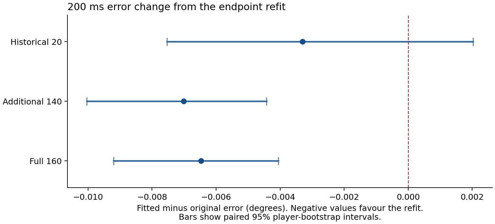

# Frozen k8 benchmark comparison

On all 160 test players the endpoint refit scored **4.51355°**, the original 800-user model scored **4.52002°**, and the previous +5% edit scored **4.51650°**. The refit improved 115/160 players versus the original. The paired 95% interval for fitted minus original error was [-0.00920°, -0.00406°].

The headline score is window-weighted mean geodesic error 200 ms ahead, streaming from each segment’s start. Lower is better. All models use their frozen weights. The 800-user refit and original have the same architecture and training cohort. The previous +5% edit uses the same source checkpoint.

## Direct comparison of the 800-user models

| Cohort | Windows | Original (°) | +5% edit (°) | Refit (°) | Refit − original (°), 95% interval | Players improved |
| --- | ---: | ---: | ---: | ---: | --- | ---: |
| Historical 20 | 931,051 | 4.21414 | 4.21307 | 4.21084 | -0.00330 [-0.00753, +0.00203] | 15/20 |
| Additional 140 | 5,428,916 | 4.57248 | 4.56853 | 4.56546 | -0.00701 [-0.01004, -0.00442] | 100/140 |
| Full 160 | 6,359,967 | 4.52002 | 4.51650 | 4.51355 | -0.00647 [-0.00920, -0.00406] | 115/160 |

The full 160 include both smaller groups. The additional 140 provide a separate look at the players outside the team leaderboard. The project had already evaluated earlier k8 models on this cohort. Intervals use 10,000 paired player-bootstrap draws with seed 0. The additional-140 quantiles use the archived float32 endpoint errors. The cohort means and paired comparisons use float64 per-player sums.

## Previous iterations on the standard team benchmark

| Model | 200 ms (°) | 100 ms (°) | Cold-start 200 ms (°) | Endpoint p95 (°) | Parameters | MACs/call | 1-thread median (µs) |
| --- | ---: | ---: | ---: | ---: | ---: | ---: | ---: |
| 800-user k8, endpoint refit | 4.21084 | 2.16191 | 4.23042 | 9.7618 | 7,555 | 16,222 | 56.3 |
| 800-user k8, original | 4.21414 | 2.16262 | 4.23408 | 9.7745 | 7,555 | 16,222 | 55.9 |
| 800-user k8, previous +5% edit | 4.21307 | 2.15983 | 4.23449 | 9.7627 | 7,555 | 16,222 | 55.7 |
| 100-user k8 | 4.26658 | 2.18869 | 4.27132 | 9.8971 | 7,555 | 16,222 | 56.0 |
| 100-user k5 | 4.28713 | 2.19823 | 4.29373 | 9.9422 | 5,595 | 12,318 | 62.8 |
| v7 sep + angular | 4.32892 | 2.20966 | 4.33149 | 10.0503 | 6,651 | 13,863 | 91.4 |
| v6 TCNN | 4.35838 | 2.23048 | 4.36243 | 10.0532 | 26,012 | 52,144 | 124.6 |
| v5 TCNN | 4.45340 | 2.25954 | 4.45600 | 10.2838 | 51,900 | 51,920 | 96.1 |
| Nic GRU, seed 45 | 4.45736 | 2.25966 | 4.45986 | 10.2634 | 6,192 | 6,384 | 24.1 |
| Nic GADS-T, seed 42 | 4.44594 | 2.29582 | — | 10.3051 | 10,352 | 606,320 | 174.5 |
| Hold last | 6.03726 | 3.47326 | — | 14.1979 | 0 | — | — |
| Damped velocity | 5.11374 | 2.59029 | — | 11.7818 | 0 | — | — |
| Constant velocity | 6.94382 | 3.05423 | — | 16.6184 | 0 | — | — |

The earlier learned models in this table trained on 100 users. Differences against those models also include changes in training data and recipe. The 800-user original isolates the incremental contribution of the refit. The historical accuracy records reuse the same fingerprint and windows. Latencies were measured together in a new local CPU session.

## Full 160-user benchmark

| Model | 200 ms (°) | 100 ms (°) | Cold-start 200 ms (°) | Median / p95 / p99 (°) | Equal-player mean (°) |
| --- | ---: | ---: | ---: | --- | ---: |
| 800-user k8, endpoint refit | 4.51355 | 2.25769 | 4.53207 | 3.632 / 10.899 / 17.363 | 4.44302 |
| 800-user k8, previous +5% edit | 4.51650 | 2.25577 | 4.53679 | 3.635 / 10.903 / 17.366 | 4.44593 |
| 800-user k8, original | 4.52002 | 2.25863 | 4.53891 | 3.635 / 10.927 / 17.427 | 4.44799 |
| 100-user k8 | 4.58396 | 2.29262 | 4.58859 | 3.682 / 11.078 / 17.652 | 4.51366 |
| 100-user k5 | 4.60401 | 2.30132 | 4.61018 | 3.698 / 11.132 / 17.785 | 4.53169 |
| v7 sep + angular | 4.66344 | 2.31153 | 4.66588 | 3.739 / 11.311 / 18.099 | 4.57962 |
| v6 TCNN | 4.67980 | 2.34001 | 4.68393 | 3.783 / 11.222 / 17.753 | 4.60280 |
| v5 TCNN | 4.78300 | 2.37083 | 4.78560 | 3.852 / 11.527 / 18.297 | 4.70128 |
| Nic GRU, seed 45 | 4.80108 | 2.37587 | 4.80385 | 3.858 / 11.593 / 18.509 | 4.72860 |
| Nic GADS-T, seed 42 | 4.81206 | 2.42015 | — | 3.846 / 11.656 / 18.900 | 4.75426 |
| Damped velocity | 5.58698 | 2.74876 | — | 4.455 / 13.698 / 22.235 | 5.47962 |
| Hold last | 6.64481 | 3.79706 | — | 5.211 / 16.632 / 27.011 | 6.45190 |
| Constant velocity | 7.47196 | 3.19332 | — | 5.859 / 18.759 / 30.671 | 7.42373 |

| Refit against comparator on 160 players | Difference (°) | 95% interval (°) | Players improved |
| --- | ---: | --- | ---: |
| 800-user k8, original | -0.00647 | [-0.00920, -0.00406] | 115/160 |
| 800-user k8, previous +5% edit | -0.00295 | [-0.00419, -0.00164] | 114/160 |
| 100-user k8 | -0.07041 | [-0.08055, -0.06147] | 153/160 |

## Verification and evidence

The frozen refit ONNX is 44,196 bytes and has 7,555 declared parameters, 7,552 stored initializer elements and 16,222 multiply-accumulates per call. It passed output-shape, finiteness, repeatability and operator checks. The maximum output difference between one and four threads was 0.

The historical benchmark fingerprint is `6303a55cc75316cc`. The expanded benchmark fingerprint is `be79081ac96bf919`. The maximum per-player, per-horizon discrepancy when reproducing the historical 20 from the merged file was 0°. All newly scored models passed the train/validation overlap check.

The single-session timing comparison used AMD Ryzen 9 7900X 12-Core Processor, ONNX Runtime 1.31.0, 1 and 4 CPU threads, and 3,000 timed calls per configuration. The organisers assess latency separately on XR hardware.

- [All accuracy and efficiency rows, including historical variants](all_model_scores.csv)
- [Paired comparisons across players](paired_comparisons.json)
- [160-user benchmark definition](definitions/merged-800-test160.json) and [additional 140 scores](additional_140_scores.json)
- [Model and data hashes](benchmark_inputs.json), [nested-cohort verification](nested_cohort_check.json), and [latency session](latency_controlled.json)
- [Standard benchmark score records](scores/group-a-v2-test20) and [expanded score records](scores/merged-800-test160)
- [Frozen refit ONNX](frozen_models/k8_800_refit_s44.onnx), [original ONNX](frozen_models/k8_800_original_s44.onnx), and [previous edit ONNX](frozen_models/k8_800_gain105_s44.onnx)
- [Cross-check against earlier 160-user evaluations](existing_scores_check.json) and [previous edit export verification](prior_gain_export_receipt.json)
- `run_benchmark.py` runs the team scorer with separate comparison outputs. Its `--expanded-comparators` pass scores the historical models and baselines and records the final timing session. `compare.py` verifies the scores and builds this report.
