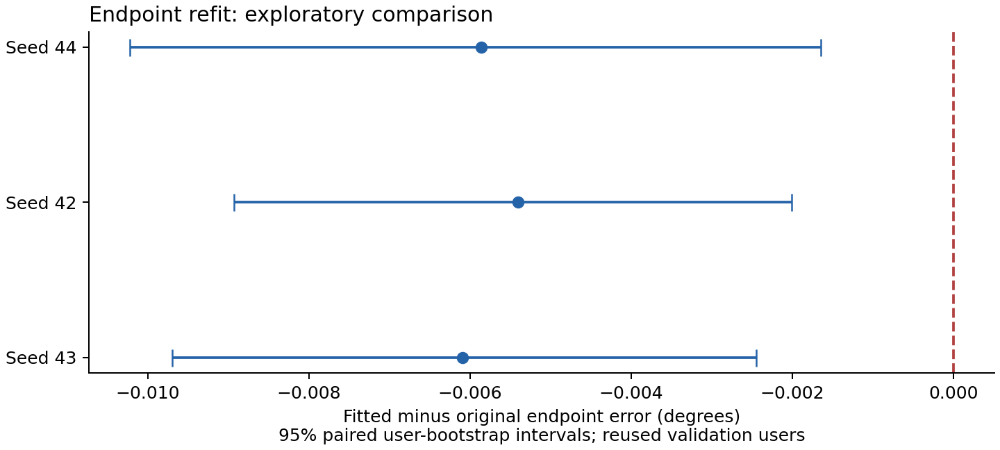
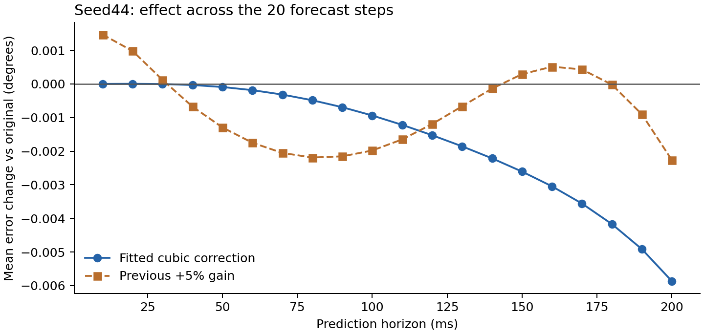

# Endpoint refit on the 800-user k8 model

The experiment ran on `codex/k8-weight-edit` for 34.0 minutes. Both validation subsets were used in earlier work. The 160 test users remain reserved.

**Result.** The run met the criteria for `promising_exploratory`. On the 40 reused validation users, seed 44's mean endpoint error went from 4.47235° to 4.46649°. The fit improved 28/40 users. Performance on fresh users is still an open question.

## What was fitted

Only the 97 cubic-term output coefficients were fitted. The temporal feature extractor stayed frozen. The fit used 1,620,028 stride-20 examples from all 800 training users, a sign-invariant quaternion alignment objective, regularization toward the original model, and a 10% cap on the training RMS change in endpoint residual. The CPU solved the coefficients directly. Both models have 7,555 parameters.

Seven penalties and three correction strengths produced 21 fits, compared with the original weights and the prior 1.05-gain edit. All fitted seed 44 checkpoints are saved in the separate run folder.

## Selection

The stride-5 selection winner was **ridge_0.0001_strength_1**.

| Candidate | Endpoint error (°) | Change vs original (°) |
| --- | ---: | ---: |
| ridge_0.0001_strength_1 | 4.366541 | -0.003229 |
| ridge_0.001_strength_1 | 4.366573 | -0.003196 |
| ridge_0.01_strength_1 | 4.366843 | -0.002926 |
| ridge_0.0001_strength_0.5 | 4.367558 | -0.002211 |
| ridge_0.001_strength_0.5 | 4.367593 | -0.002176 |
| ridge_0.01_strength_0.5 | 4.367846 | -0.001923 |
| ridge_0.1_strength_1 | 4.367948 | -0.001821 |
| global_105 | 4.368126 | -0.001643 |
| ridge_0.0001_strength_0.25 | 4.368514 | -0.001255 |
| ridge_0.001_strength_0.25 | 4.368536 | -0.001233 |
| ridge_0.1_strength_0.5 | 4.368687 | -0.001082 |
| ridge_0.01_strength_0.25 | 4.368693 | -0.001077 |
| ridge_0.1_strength_0.25 | 4.369185 | -0.000584 |
| ridge_1_strength_1 | 4.369239 | -0.000531 |
| ridge_1_strength_0.5 | 4.369488 | -0.000281 |
| ridge_1_strength_0.25 | 4.369625 | -0.000145 |
| ridge_10_strength_1 | 4.369694 | -0.000076 |
| ridge_10_strength_0.5 | 4.369731 | -0.000038 |
| ridge_10_strength_0.25 | 4.369750 | -0.000019 |
| ridge_100_strength_1 | 4.369761 | -0.000008 |
| ridge_100_strength_0.5 | 4.369765 | -0.000004 |
| ridge_100_strength_0.25 | 4.369767 | -0.000002 |
| identity | 4.369769 | +0.000000 |

On all 3,150,322 stride-1 selection windows, the original scored 4.368606°, the previous gain scored 4.366870°, and the fitted copy scored 4.365346°.

The frozen fit used penalty **0.0001**, strength **1**, and RMS cap multiplier **1.000000** for seed 44.

## Reused 40-user assessment

Negative differences favour the fitted model. Intervals resample users with 10,000 draws, seed0. The three source seeds share the same users.

| Seed | Original (°) | Previous gain (°) | Fitted (°) | Fitted − original (°) | 95% interval | Users improved |
| --- | ---: | ---: | ---: | ---: | --- | ---: |
| 44 | 4.472353 | 4.470089 | 4.466487 | -0.005866 | [-0.010226, -0.001650] | 28/40 |
| 42 | 4.477778 | 4.475536 | 4.472369 | -0.005409 | [-0.008931, -0.002009] | 28/40 |
| 43 | 4.475524 | 4.473074 | 4.469430 | -0.006094 | [-0.009700, -0.002452] | 31/40 |

Seed 44 passed all predeclared assessment checks.

| Seed 44 measure (°) | Original | Previous gain | Fitted |
| --- | ---: | ---: | ---: |
| Equal-user endpoint mean | 4.444151 | 4.442268 | 4.439640 |
| Endpoint median | 3.628432 | 3.629333 | 3.625752 |
| Endpoint p95 | 10.594393 | 10.578930 | 10.568431 |
| Endpoint p99 | 17.147543 | 17.118764 | 17.103999 |
| Mean across all horizons | 2.331978 | 2.331223 | 2.330293 |

The per-user files retain every horizon and both paired comparisons. The fit stayed frozen throughout this assessment.

These are descriptive means on the 40 reused users. Negative values indicate improvements. The scored endpoint is 200 ms.

## Streaming export

Both ONNX files contain 44,196 bytes, 124 nodes and 16,222 multiply-accumulates per call. Both satisfy the operator audit. The largest fitted ONNX versus PyTorch window discrepancy was 0.0001036° on 650 synthetic samples.

| Single-thread CPU latency | Original | Fitted |
| --- | ---: | ---: |
| Median (µs) | 55.7 | 55.5 |
| p95 (µs) | 65.8 | 66.2 |

Timing used five alternating rounds on this PC. The small differences fall within the variation across rounds. The organisers measure deployment latency on their XR hardware.

## Preservation and verification

All three original checkpoints and preserved copies match their hashes. The first experiment's recorded artifacts and all recorded source files match their hashes. Every saved fitted checkpoint matches its source plus the recorded cubic correction. The team's benchmark statistic reproduced the paired intervals and user counts.

30 unit tests passed, plus a CUDA smoke check. Tests cover the independent projector equations, known coefficient recovery, regularization limits, inactive features, near-180-degree targets, mirror/sign/yaw invariance, cubic timing, saved copies, data-split guards and actual-model/cache parity.

The fitted checkpoints contain inference weights and fit provenance. The team retains control of model promotion and Git publication.

## Files

- Run outputs and model copies: `<repo>\jacob\training\outputs\v10_endpoint_refit_20261105`
- [Manifest](manifest.json), [complete screen](screen.json), [final status](status.json), [integrity audit](integrity_audit.json), [run log](run.log)
- [Implementation and reproducibility instructions](../../../training/experimental/v10_endpoint_refit/README.md)
- [Separate fitted model](../../../training/outputs/v10_endpoint_refit_20261105/candidate_model.pt)
- [Fitted streaming ONNX](../../../training/outputs/v10_endpoint_refit_20261105/onnx/edited.onnx) and [verification results](export_checks.json)
