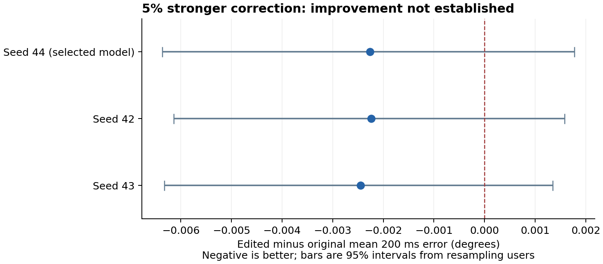

# Direct weight-edit pilot: no confirmed improvement

The pilot completed on 4 November 2026 in 28 min 50 s. Results and preservation were independently checked on 5 November. Work is on `codex/k8-weight-edit`; nothing was staged, committed, pushed or promoted.

**Conclusion:** a 5% increase in the learned correction produced a small observed improvement, but its confidence interval includes no improvement. The predeclared confirmation gate failed. Keep the original as the reference model; retain the edited copy as experimental evidence.

## What changed

Starting point: the 800-user k8 model, selected seed 44, with 7,555 parameters. The experiment copied the original checkpoint before editing. Seeds 42 and 43 were also copied for confirmation.

The head produces three polynomial terms for each rotation axis. The selected edit multiplies all 288 head weights and all three existing x-axis bias values by 1.05. Thus it increases the **learned residual correction** by 5%; it does not scale the full forecast or the damped-motion prior. Temporal filters, architecture, state, output shape and parameter count are unchanged. There was no gradient training or fine-tuning.

This is gradient-free post-training calibration inspired by [Sparks of Weight-Space Programming](https://rikiyat.github.io/blog/weight-space-programming/), not evidence of a broader ability to infer network mechanisms from raw weight values.

## Protocol and results

The 120 validation users were sorted by SHA-256 of `v10-weight-edit-v1:<user_id>`, then split into 80 selection users and 40 confirmation users. Selection compared gains 0.90, 0.95, 1.05 and 1.10, applied globally or to one axis: 16 edits plus the unchanged model.

| Stage | Users | Windows | Original error | Edited error | Change |
| --- | ---: | ---: | ---: | ---: | ---: |
| Baseline reproduction, all validation | 120 | 4,755,761 | 4.403629° | — | 0.000000° vs recorded |
| Selection screen, stride 5 | 80 | 630,163 | 4.369769° | 4.368126° | −0.001643° |
| Full selection check, stride 1 | 80 | 3,150,322 | 4.368606° | 4.366870° | −0.001737° |

`global_105` ranked first; unchanged weights ranked fifth. The exact edit was locked at 22:24:54 UTC, before any candidate confirmation results. The same gains were then applied to all three seeds without retuning. Full confirmation used actual copied-model inference, not only cached calculations.

### Confirmation: 40 users, 1,605,439 windows per seed

Errors are mean geodesic angles at sample 20, 200 ms ahead. Negative differences favour the edit. Intervals use 10,000 paired user-bootstrap draws, seed 0.

| Seed | Original | Edited | Edited − original | 95% interval | Users improved |
| --- | ---: | ---: | ---: | --- | ---: |
| **44, selected model** | **4.472353°** | **4.470089°** | **−0.002264°** | **[−0.006367°, +0.001776°]** | **22/40** |
| 42 | 4.477778° | 4.475536° | −0.002242° | [−0.006143°, +0.001578°] | 21/40 |
| 43 | 4.475524° | 4.473074° | −0.002450° | [−0.006326°, +0.001346°] | 22/40 |

The selected model's observed improvement is approximately **0.05%**. All three intervals cross zero; they do not establish a reliable gain. These seeds share the same 40 users and are not three independent confirmation cohorts.

For seed 44, the endpoint mean, equal-user mean, number of users improved, p95, and average error across all horizons passed their gates. Only the requirement that the confidence interval lie entirely below zero failed. The p95 changed from 10.594393° to 10.578930°; p99 from 17.147543° to 17.118764°. Average error across all 20 horizons decreased by 0.000755°. Some individual horizons worsened slightly, including the first three samples; every horizon is recorded in the result files.

No further search was performed after confirmation. ONNX export and latency comparison were conditional on passing confirmation and were therefore not run for this candidate. An earlier separate synthetic smoke test verified the exporter helper; it is not a measured result for this candidate.

## Preservation and verification

- All three original checkpoint files and their three preserved copies retain their recorded SHA-256 hashes.
- Exactly **291 scalar values** changed in the saved candidate: `head.weight` (288) and `head_bias_x` (3). Every other tensor and the model specification are identical.
- All 15 recorded experiment and dependency source-file hashes remain unchanged.
- Baseline reproduction differs from the recorded score by only 2.06 × 10⁻¹¹ degrees. Cached identity predictions matched the original exactly.
- **18 tests passed**, covering actual checkpoint edits, cached/actual parity at every horizon, quaternion sign/mirror/yaw invariance, original preservation, window boundaries, validation-only access, paired statistics and saved-copy reloads.
- **No test samples were evaluated.** The 40 confirmation users were withheld from this edit selection, but had previously influenced base-model early stopping and seed selection. They are not a pristine holdout.

The edited checkpoint is smaller on disk because it omits optimizer/raw-training metadata. That is **not model compression**: parameter count remains 7,555.

## Artifacts and reproduction

- [Separate edited checkpoint](../../../training/outputs/v10_weight_edit_20261104/candidate_model.pt)
- [Preserved seed-44 copy](../../../training/outputs/v10_weight_edit_20261104/originals/seed_44.pt)
- [Original selected model](../../../training/outputs/v10_k8_800users_full_pass/full_pass/selected_model.pt)
- [Experiment code and instructions](../../../training/experimental/v10_weight_edit/README.md)
- [Frozen edit](frozen_edit.json), [complete 17-entry screen](screen.json), [manifest and hashes](manifest.json), [integrity audit](integrity_audit.json)
- [Seed-44 confirmation](confirmation_seed_44.json), [seed-42 confirmation](confirmation_seed_42.json), [seed-43 confirmation](confirmation_seed_43.json)
- [Final status](status.json), [run log](run.log), [vector figure](confirmation_intervals.svg)

The raw cache and original model copies remain in the separate ignored run-output folder. This report directory retains the small result files for review without modifying any previous ablation record. To reproduce, use the package instructions with a **new** output directory; the runner refuses to overwrite an existing run.
